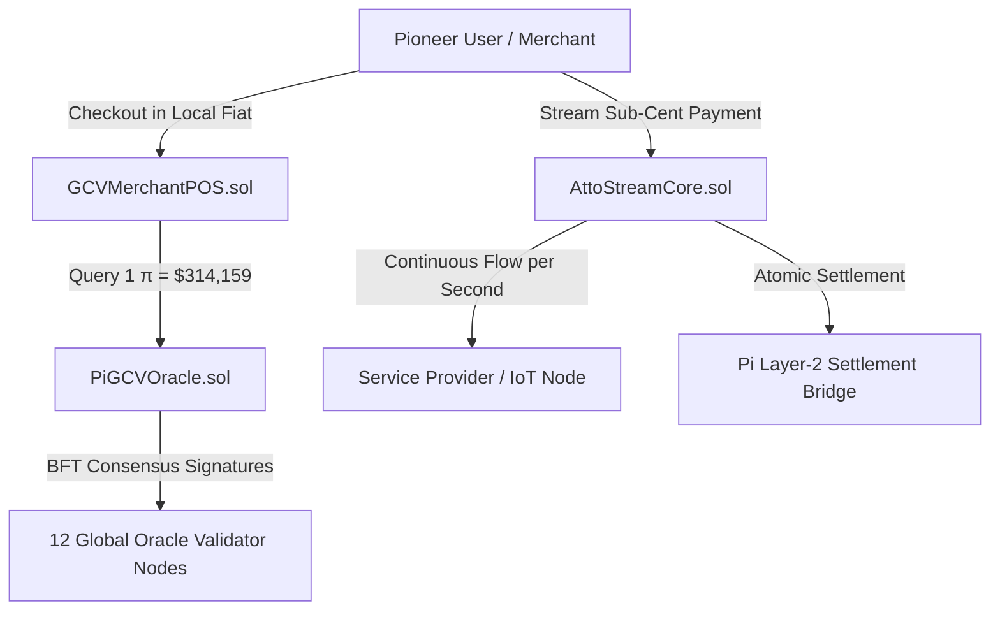

# ⚡ PiGCV-AttoStream Protocol

[](https://opensource.org/licenses/MIT)
[](#)
[](https://soliditylang.org/)
[](#)
[](#)

> **High-Precision Micro-Streaming & Fractional Point-of-Sale Settlement Protocol for the $314,159 Pi Network Global Consensus Value (GCV) Economy.**

---

## 🌟 Executive Summary

In an economic framework where **1 Pi ($\pi$) = $314,159.00 USD**, traditional cryptocurrency accounting and transaction fee mechanics encounter severe **fractional dust and rounding breakdown**:
- A single cup of coffee ($3.50 USD) equals **$0.00001114085444\ \pi$**.
- A 1-second API call ($0.001 USD) equals **$0.00000000318284\ \pi$**.

Standard blockchain wallets and EVM/Stellar float layers struggle with sub-satoshi dust thresholds and rounding truncation.

**PiGCV-AttoStream** solves this by establishing:
1. **The Pi Sub-Unit Standard**: Formalizes high-precision decimal units from **Milli-Pi** ($10^{-3}$) down to **Atto-Pi** ($10^{-18}$).
2. **AttoStream Core**: A continuous Layer-2 payment streaming engine that streams Atto-Pi per second for continuous services (WiFi, EV charging, micro-tasks).
3. **GCV Multi-Validator Oracle**: Byzantine Fault Tolerant price feed anchoring the $314,159.00 consensus rate with EIP-712 cryptographic proofs.
4. **Merchant POS Terminal Engine**: Real-time Point-of-Sale checkout that converts local fiat directly into exact integer micro-units without floating-point error.

---

## 📐 The Pi GCV Sub-Unit Standard ($1\ \pi = \$314,159$)

| Unit Symbol | Name | Factor ($\pi$) | USD Value Equivalent | Practical Everyday Usage |
| :--- | :--- | :--- | :--- | :--- |
| **$\pi$** | Full Pi | $10^{0}$ | **$314,159.00** | Real Estate, Luxury Assets |
| **$\text{m}\pi$** | Milli-Pi | $10^{-3}$ | **$314.159** | Smartphones, Appliances, Flight Tickets |
| **$\mu\pi$** | Micro-Pi | $10^{-6}$ | **$0.314159$** | Coffee, Lunch, Groceries, Gasoline |
| **$\text{n}\pi$** | Nano-Pi | $10^{-9}$ | **$0.000314159$** | Per-minute Wi-Fi, Metro fares, Tips |
| **$\text{p}\pi$** | Pico-Pi | $10^{-12}$ | **$0.000000314$** | AI Token inference, IoT Telemetry |
| **$\text{a}\pi$** | Atto-Pi | $10^{-18}$ | **$0.000000000000314$** | Base atomic unit for zero-loss arithmetic |

---

## 🏗️ Architecture Overview



---

## 📂 Repository Structure

```
.
├── contracts/
│   ├── PiGCVOracle.sol       # BFT Multi-Validator Oracle pegging $314,159 rate
│   ├── AttoStreamCore.sol    # Real-time micro-payment streaming protocol
│   └── GCVMerchantPOS.sol    # Point-of-Sale instant checkout & invoice router
├── sdk/
│   ├── gcv-units.js          # High-precision BigInt conversion library
│   ├── atto-pi.js            # AttoStream client simulator & channel manager
│   └── test.js               # Mathematical verification test suite
├── docs/
│   └── WHITEPAPER_GCV314K.md # Full technical specification & whitepaper
├── index.html                # Interactive Web3 DApp Dashboard
├── style.css                 # Cyberpunk Glassmorphism Dark Theme
├── app.js                    # Frontend state machine & simulator logic
└── package.json              # Project manifests & scripts
```

---

## 🚀 Quickstart & Interactive Testing

### 1. Run the Mathematical Test Suite
Ensure Node.js (v18+) is installed:
```bash
node sdk/test.js
```
*Validates that 1 Pi = $314,159 and checks all conversion invariants across real-world price benchmarks.*

### 2. Launch the Interactive DApp Dashboard
You can open `index.html` directly in any modern browser, or launch a local server:
```bash
npx serve .
```
Access the dashboard at `http://localhost:3000` to interact with:
- **GCV Fractional Calculator**: Instant unit converter with real-world presets.
- **Live Micro-Stream Engine**: Real-time 100ms streaming ticker with progress visualizer.
- **Merchant POS Terminal**: Tap-to-pay simulation with Pioneer wallet balance settlement.
- **BFT Oracle Monitor**: 12 globally distributed consensus validator nodes.
- **Contract Explorer**: Direct inspection of Solidity contracts.

---

## 📜 Smart Contract Reference

### 1. `PiGCVOracle.sol`
Implements Chainlink-compatible aggregator interfaces:
```solidity
function usdToAttoPi(uint256 usdWith8Decimals) external pure returns (uint256);
function attoPiToUsd(uint256 attoPiAmount) external pure returns (uint256);
```

### 2. `AttoStreamCore.sol`
Creates continuous flow channels:
```solidity
function createStream(
    address recipient,
    uint256 depositAtto,
    uint256 startTime,
    uint256 stopTime
) external payable returns (uint256);
```

### 3. `GCVMerchantPOS.sol`
Generates non-custodial fiat-pegged QR invoices:
```solidity
function createInvoice(uint256 fiatAmountUsd8, string calldata metadata) external returns (uint256);
function payInvoice(uint256 invoiceId) external payable returns (bool);
```

---

## 📄 License
MIT License. Open-source contribution to the Pi Network developer research ecosystem.
